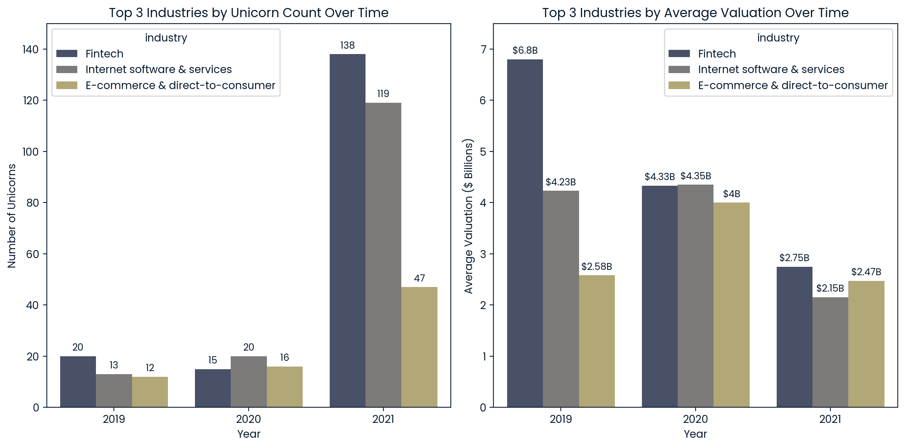

# Unicorn Industry Analysis (2019–2021)

## Project Overview

A unicorn is a privately held company valued at $1 billion or more. This project looks at companies that became unicorns from 2019 to 2021 to find which industries had the most new unicorns and compare their average valuations over the same period.

**Business question:** Which industries produced the most new unicorns between 2019 and 2021, and how did their yearly unicorn counts and average valuations compare?

## Tools Used

- **PostgreSQL / SQL** — to explore the tables, check data quality, and calculate the results.
- **Python** — to create visualizations using pandas, Matplotlib, and Seaborn.

## Data

The `datasets/` folder contains the CSV files used for this analysis. The tables used are:

- `dates` — identifies when a company became a unicorn.
- `industries` — identifies each company's industry.
- `funding` — contains company valuation and funding information.
- `companies` — contains company identifiers and names; it is used for data quality checks.

## Approach

1. Preview the source tables and review their columns.
2. Check for duplicate company IDs in `funding`, missing valuations, missing or blank industry values, and missing company/industry/date records.
3. Identify the three industries with the most new unicorns from 2019 through 2021.
4. Count new unicorns by industry and year and calculate average valuation in billions of US dollars.
5. Use Python to visualize the annual counts and average valuations.

## Visualizations

The charts below compare the number of new unicorns with average company valuations for the three industries in 2019, 2020, and 2021.

## Key Findings

- **Fintech had the most new unicorns in 2021**, with 138, followed by Internet software & services with 119 and E-commerce & direct-to-consumer with 47.
- **All three industries had more new unicorns in 2021 than in 2020.** Fintech increased from 15 to 138, Internet software & services from 20 to 119, and E-commerce & direct-to-consumer from 16 to 47.
- **Average valuations were lower in 2021 than in 2019 across all three industries.** Fintech decreased from $6.80 billion to $2.75 billion, Internet software & services from $4.23 billion to $2.15 billion, and E-commerce & direct-to-consumer from $2.58 billion to $2.47 billion.
- The industry with the most new unicorns did not also have the highest average valuation in 2021. Fintech led in count, while E-commerce & direct-to-consumer had the highest average valuation of the three at $2.47 billion.

## Data Quality Checks

All six SQL data quality checks returned zero rows. The checks covered duplicate company IDs in the funding table, missing valuations, missing or blank industry values, companies without a matching industry record, missing `date_joined` values, and companies without a matching date record. These checks did not identify issues in the specific cases tested, but they do not rule out every possible data quality issue.

## Limitations

- The analysis covers only 2019–2021 and may not reflect more recent market conditions.
- A company's valuation does not necessarily mean the company is profitable.
- Average valuations can be affected by unusually high or low company valuations and may not represent every company in an industry.
- The findings depend on the accuracy and completeness of the source data.

## Project Files

- [`unicorn_analysis.sql`](unicorn_analysis.sql) — SQL table previews, data quality checks, and main analysis query.
- [`unicorn_analysis.ipynb`](unicorn_analysis.ipynb) — project walkthrough, main analysis query result, charts, key findings, and limitations.
- [`datasets/`](datasets/) — source CSV files.
- [`unicorn_final_result.csv`](unicorn_final_result.csv) — main analysis query result.
- [`unicorn_analysis_charts.png`](unicorn_analysis_charts.png) — chart image shown in this README.
